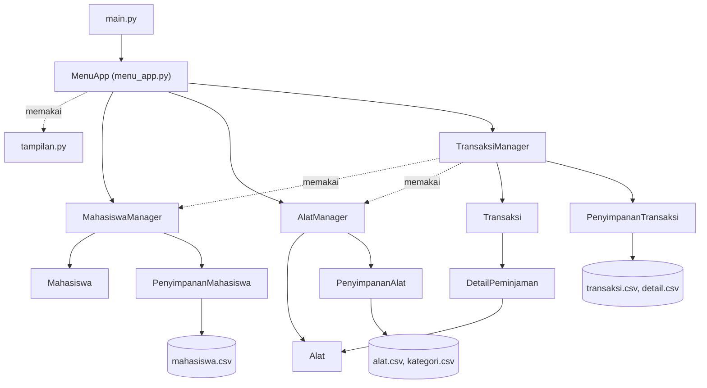

<div align="center">

# Sistem Peminjaman Peralatan Laboratorium

**Aplikasi terminal berbasis Python OOP untuk mencatat peminjaman alat laboratorium oleh mahasiswa.**

</div>

## Daftar Isi

1. [Nama Aplikasi](#nama-aplikasi)
2. [Anggota Kelompok](#anggota-kelompok)
3. [Deskripsi Sistem](#deskripsi-sistem)
4. [Struktur Program](#struktur-program)
5. [Cara Menjalankan](#cara-menjalankan)
6. [Pembagian Kontribusi](#pembagian-kontribusi)


## Nama Aplikasi

**Sistem Peminjaman Peralatan Laboratorium**

Aplikasi ini dibuat dengan Python dan dijalankan lewat terminal. Data disimpan di file **CSV** (folder `Data_Sistem/`) dan **tersimpan otomatis** setiap selesai satu aksi, tanpa database.


## Anggota Kelompok

**Kelompok 3**

| No | Nama | NIM | Akun GitHub |
|:--:|------|-----|-------------|
| 1 | Farrel Muflif Muzzaki | K3525024 | [@relzajaa](https://github.com/relzajaa) |
| 2 | Gisma Dian Utami | K3525026 | [@gismadian](https://github.com/gismadian) |
| 3 | Nourin Akbar Pratama | K3525067 | [@Akbarr-11](https://github.com/Akbarr-11) |
| 4 | Azzahra Hendar Asafira | K3525081 | [@azzahrahendar](https://github.com/azzahrahendar) |


## Deskripsi Sistem

Sistem ini membantu petugas lab mencatat **siapa** meminjam **alat apa**, **kapan** harus kembali, dan **bagaimana kondisi** alat saat dikembalikan.

### Fitur

| Menu | Fitur | Keterangan |
|:--:|-------|------------|
| 1 | Kelola Data Mahasiswa | Tambah, edit, hapus, cari (NIM atau nama), dan lihat daftar mahasiswa |
| 2 | Kelola Data Alat | Tambah (bisa banyak unit sekaligus), edit, hapus, cari, lihat daftar, dan tambah kategori |
| 3 | Buat Transaksi Peminjaman | Satu transaksi boleh berisi beberapa alat, lama pinjam 1-7 hari |
| 4 | Tampilkan Transaksi | Semua transaksi, bisa dilanjutkan melihat detail lewat ID, ada tanda **TERLAMBAT** |
| 5 | Proses Pengembalian Alat | Alat dikembalikan satu per satu, lengkap dengan kondisi dan tanggal |
| 6 | Cari Transaksi Berdasarkan Mahasiswa | Cari memakai NIM |
| 7 | Tampilkan Alat yang Tersedia | Daftar alat + jumlah stok |
| 8 | Tampilkan Alat yang Sedang Dipinjam | Daftar alat yang belum kembali |
| 9 | Tampilkan Alat yang Rusak | Daftar alat yang kondisinya tidak baik |
| 10 | Tampilkan Riwayat Peminjaman Mahasiswa | Transaksi yang sudah selesai, terbaru di atas |
| 11 | Keluar dari Program | Menutup aplikasi |
| 12 | Pencarian Alat | Cari berdasarkan kode, nama, atau kategori |
| 13 | Statistik Peminjaman | Alat terpopuler, mahasiswa teraktif (masing-masing 5 teratas), jumlah transaksi aktif dan selesai |
| 14 | Lihat Alat dalam Pemeliharaan | Daftar alat yang sedang dipelihara |
| 15 | Selesaikan Pemeliharaan Alat | Alat selesai dipelihara lalu kembali tersedia dalam kondisi baik |


### Aturan Peminjaman

1. Satu mahasiswa maksimal punya **2 transaksi aktif**.
2. Alat hanya bisa dipinjam jika statusnya **Tersedia**.
3. Satu transaksi bisa berisi **banyak alat**. Kode alat yang diketik dua kali dihitung sekali. Lama pinjam 1-7 hari (jika dikosongkan, 7 hari).
4. Pengembalian dicatat **per alat** (tanggal, kondisi, dan hari terlambat). Status transaksi berubah otomatis: *Dipinjam -> Sebagian dikembalikan -> Selesai*.
5. Alat yang kembali **Baik** langsung tersedia. Alat yang kembali **Rusak ringan** atau **Rusak berat** otomatis masuk status *Pemeliharaan* sampai diselesaikan lewat menu 15, lalu kembali tersedia dalam kondisi baik.
6. Mahasiswa atau alat yang sudah memiliki riwayat transaksi **tidak bisa dihapus**, karena riwayat disimpan permanen.

### Pemeriksaan Input

- NIM dan kode alat tidak boleh sama dengan yang sudah ada.
- Nama mahasiswa wajib diisi.
- No. HP hanya angka, panjang 10-13 digit.
- Jumlah unit alat yang ditambah sekaligus 1-100.
- Tanggal kembali berformat `DD-MM-YYYY` (Enter = hari ini) dan tidak boleh sebelum tanggal pinjam.
- Jika ada kesalahan, muncul pesan `[!]` berwarna merah dan program tidak berhenti.

### Tampilan Program

Ini tampilan menu utama saat program dijalankan (garis dan kotak berwarna kuning, tulisan berwarna putih):

<pre style="background:#0c0c0c; color:#ffffff; padding:12px; overflow-x:auto; line-height:1.3">
      <span style="color:#F5F543">╔══════════════════════════════════════════════════════════════════╗</span>
      <span style="color:#F5F543">║</span>          <span style="color:#F5F543"><b>♦</b></span>  <b>SISTEM PEMINJAMAN PERALATAN LABORATORIUM</b>  <span style="color:#F5F543"><b>♦</b></span>          <span style="color:#F5F543">║</span>
      <span style="color:#F5F543">╚══════════════════════════════════════════════════════════════════╝</span>

                 Hari ini: 12-10-2026   |   Transaksi aktif: 0                  

      <span style="color:#F5F543">┌──────────────────────────────────────────────────────────────────┐</span>
      <span style="color:#F5F543">│</span>                            <b>MENU UTAMA</b>                            <span style="color:#F5F543">│</span>
      <span style="color:#F5F543">╞══════════════════════════════════════════════════════════════════╡</span>
      <span style="color:#F5F543">│</span>  1. Kelola Data Mahasiswa                                        <span style="color:#F5F543">│</span>
      <span style="color:#F5F543">│</span>  2. Kelola Data Alat                                             <span style="color:#F5F543">│</span>
      <span style="color:#F5F543">│</span>  3. Buat Transaksi Peminjaman                                    <span style="color:#F5F543">│</span>
      <span style="color:#F5F543">│</span>  4. Tampilkan Transaksi                                          <span style="color:#F5F543">│</span>
      <span style="color:#F5F543">│</span>  5. Proses Pengembalian Alat                                     <span style="color:#F5F543">│</span>
      <span style="color:#F5F543">│</span>  6. Cari Transaksi Berdasarkan Mahasiswa                         <span style="color:#F5F543">│</span>
      <span style="color:#F5F543">│</span>  7. Tampilkan Alat yang Tersedia                                 <span style="color:#F5F543">│</span>
      <span style="color:#F5F543">│</span>  8. Tampilkan Alat yang Sedang Dipinjam                          <span style="color:#F5F543">│</span>
      <span style="color:#F5F543">│</span>  9. Tampilkan Alat yang Rusak                                    <span style="color:#F5F543">│</span>
      <span style="color:#F5F543">│</span> 10. Tampilkan Riwayat Peminjaman Mahasiswa                       <span style="color:#F5F543">│</span>
      <span style="color:#F5F543">│</span> 11. Keluar dari Program                                          <span style="color:#F5F543">│</span>
      <span style="color:#F5F543">└──────────────────────────────────────────────────────────────────┘</span>

      <span style="color:#F5F543">┌──────────────────────────────────────────────────────────────────┐</span>
      <span style="color:#F5F543">│</span>                          <b>MENU TANTANGAN</b>                          <span style="color:#F5F543">│</span>
      <span style="color:#F5F543">╞══════════════════════════════════════════════════════════════════╡</span>
      <span style="color:#F5F543">│</span> 12. Pencarian Alat                                               <span style="color:#F5F543">│</span>
      <span style="color:#F5F543">│</span> 13. Statistik Peminjaman                                         <span style="color:#F5F543">│</span>
      <span style="color:#F5F543">│</span> 14. Lihat Alat dalam Pemeliharaan                                <span style="color:#F5F543">│</span>
      <span style="color:#F5F543">│</span> 15. Selesaikan Pemeliharaan Alat                                 <span style="color:#F5F543">│</span>
      <span style="color:#F5F543">└──────────────────────────────────────────────────────────────────┘</span>

      Pilih menu (1-15): 
</pre>


## Struktur Program

### Susunan Folder

```text
Project2_FIX/
├── main.py                    # pintu masuk program
├── README.md
├── Data_Sistem/               # file data (CSV)
│   ├── mahasiswa.csv
│   ├── alat.csv
│   ├── kategori.csv
│   ├── transaksi.csv
│   └── detail.csv
└── Sistem_Peminjaman_Lab/
    ├── __init__.py
    ├── mahasiswa.py           # class Mahasiswa, penyimpanan CSV, dan manager
    ├── alat.py                # Enum, class Alat, penyimpanan CSV, dan manager
    ├── transaksi.py           # Enum, class transaksi, penyimpanan CSV, dan manager
    ├── menu_app.py            # menu dan alur input (UI)
    └── tampilan.py            # fungsi bantu cetak di terminal
```

### Tiga Lapisan Program



| Lapisan | File | Tugas |
|---------|------|-------|
| **UI** | `menu_app.py`, `tampilan.py` | Menampilkan menu dan tabel, membaca input, menangkap pesan error |
| **Manager dan Domain** | `mahasiswa.py`, `alat.py`, `transaksi.py` | Objek data (mahasiswa, alat, transaksi), pilihan tetap (Enum), penyimpanan di `dict`, dan pemeriksaan aturan |
| **Penyimpanan** | `Data_Sistem/*.csv` | Menyimpan data ke file CSV dan membacanya kembali saat program dijalankan |

### Class dan Enum (11 class + 3 enum)

| Jenis | Nama | File | Tugas |
|-------|------|------|-------|
| Class | `MenuApp` | `menu_app.py` | Menjalankan menu 1-15 dan submenunya |
| Class | `Mahasiswa` | `mahasiswa.py` | Data mahasiswa dan daftar transaksi aktifnya |
| Class | `PenyimpananMahasiswa` | `mahasiswa.py` | Membaca dan menulis `mahasiswa.csv` |
| Class | `MahasiswaManager` | `mahasiswa.py` | Mengelola data mahasiswa (kunci = NIM) |
| Class | `Alat` | `alat.py` | Data alat beserta kondisi dan statusnya |
| Class | `PenyimpananAlat` | `alat.py` | Membaca dan menulis `alat.csv` dan `kategori.csv` |
| Class | `AlatManager` | `alat.py` | Mengelola data alat, kategori, dan pemeliharaan (kunci = kode alat) |
| Class | `DetailPeminjaman` | `transaksi.py` | Catatan satu alat di dalam transaksi |
| Class | `Transaksi` | `transaksi.py` | Satu peminjaman: tanggal, batas kembali, status, dan daftar alat |
| Class | `PenyimpananTransaksi` | `transaksi.py` | Membaca dan menulis `transaksi.csv` dan `detail.csv` |
| Class | `TransaksiManager` | `transaksi.py` | Membuat transaksi, memproses pengembalian, riwayat, dan statistik (kunci = ID seperti `TRX001`) |
| Enum | `StatusTransaksi` | `transaksi.py` | `DIPINJAM`, `SEBAGIAN_DIKEMBALIKAN`, `SELESAI` |
| Enum | `KondisiAlat` | `alat.py` | `BAIK`, `RUSAK_RINGAN`, `RUSAK_BERAT` |
| Enum | `StatusAlat` | `alat.py` | `TERSEDIA`, `DIPINJAM`, `PEMELIHARAAN` |

### Struktur Data yang Dipakai

| Struktur | Dipakai untuk |
|----------|---------------|
| `dict` | Tempat menyimpan data tiap manager dan daftar menu |
| `list` | Daftar alat dalam transaksi dan hasil pencarian |
| `set` | Kategori alat dan ID transaksi aktif mahasiswa (tidak boleh ganda) |
| `tuple` | Pasangan `(nama, jumlah)` pada statistik |

### File Data (CSV)

| File | Kolom | Isi |
|------|-------|-----|
| `mahasiswa.csv` | `nim`, `nama`, `noHp` | Data mahasiswa |
| `alat.csv` | `kode`, `nama`, `kategori`, `kondisi`, `status` | Data alat |
| `kategori.csv` | `kategori` | Daftar kategori alat |
| `transaksi.csv` | `id`, `nim`, `tglPinjam`, `hari` | Data transaksi peminjaman |
| `detail.csv` | `idTrx`, `kodeAlat`, `tglKembali`, `kondisiKembali` | Alat di tiap transaksi; `tglKembali` dan `kondisiKembali` kosong jika alat belum kembali |


## Cara Menjalankan

### Yang Dibutuhkan

- **Python 3**
- Terminal yang bisa menampilkan warna dan karakter Unicode
- Tidak perlu `pip install` apa pun

### Langkah-langkah

```bash
# 1. Masuk ke folder proyek
cd Project2_FIX

# 2. Jalankan program
python main.py          # Windows
python3 main.py         # macOS / Linux
```

Program juga bisa dijalankan dari editor kode dengan membuka `main.py` lalu menjalankannya (Run).

### Contoh Alur Pemakaian

Folder `Data_Sistem/` awalnya hanya berisi judul kolom (tanpa data contoh), jadi isi data dulu:

1. **Menu 1** -> tambah mahasiswa (NIM, nama, No. HP).
2. **Menu 2** -> tambah alat. Contoh: kode `MKS`, jumlah `3` -> otomatis jadi `MKS-01`, `MKS-02`, `MKS-03`.
3. **Menu 3** -> buat peminjaman (NIM, kode alat dipisah koma, lama pinjam).
4. **Menu 5** -> kembalikan alat (pilih transaksi, kode alat, kondisi, tanggal).
5. **Menu 4, 10, 13** -> lihat transaksi, riwayat, dan statistik.

> Catatan: data tersimpan di file CSV pada folder `Data_Sistem/`, jadi **tidak hilang saat program ditutup**. Tutup file CSV jika sedang dibuka di aplikasi lain (misalnya Excel) agar data bisa disimpan, dan jangan mengubah isinya secara manual dengan format yang salah karena program akan berhenti dengan pesan error saat membaca file.


## Pembagian Kontribusi

| Anggota | File yang Dikerjakan | Isi Tugas |
|---------|----------------------|-----------|
| **Farrel Muflif Muzzaki** | `mahasiswa.py`, `menu_app.py` | Class `Mahasiswa`, `PenyimpananMahasiswa`, dan `MahasiswaManager`; menu utama dan submenu, alur input pengguna, serta menu tantangan |
| **Gisma Dian Utami** | `alat.py`, `README.md` | Enum `KondisiAlat` dan `StatusAlat`; class `Alat`, `PenyimpananAlat`, dan `AlatManager`; penjelasan repository |
| **Azzahra Hendar Asafira** | `transaksi.py`, `main.py` | Enum `StatusTransaksi`; class `DetailPeminjaman`, `Transaksi`, `PenyimpananTransaksi`, dan `TransaksiManager`; pintu masuk program |
| **Nourin Akbar Pratama** | `tampilan.py`, `README.md` | Tampilan terminal (warna, kotak, dan tabel); penjelasan repository |

<div align="center">

**Created by Kelompok 3**

</div>