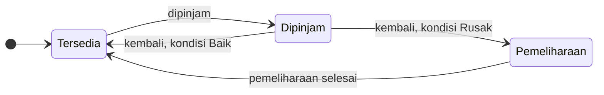
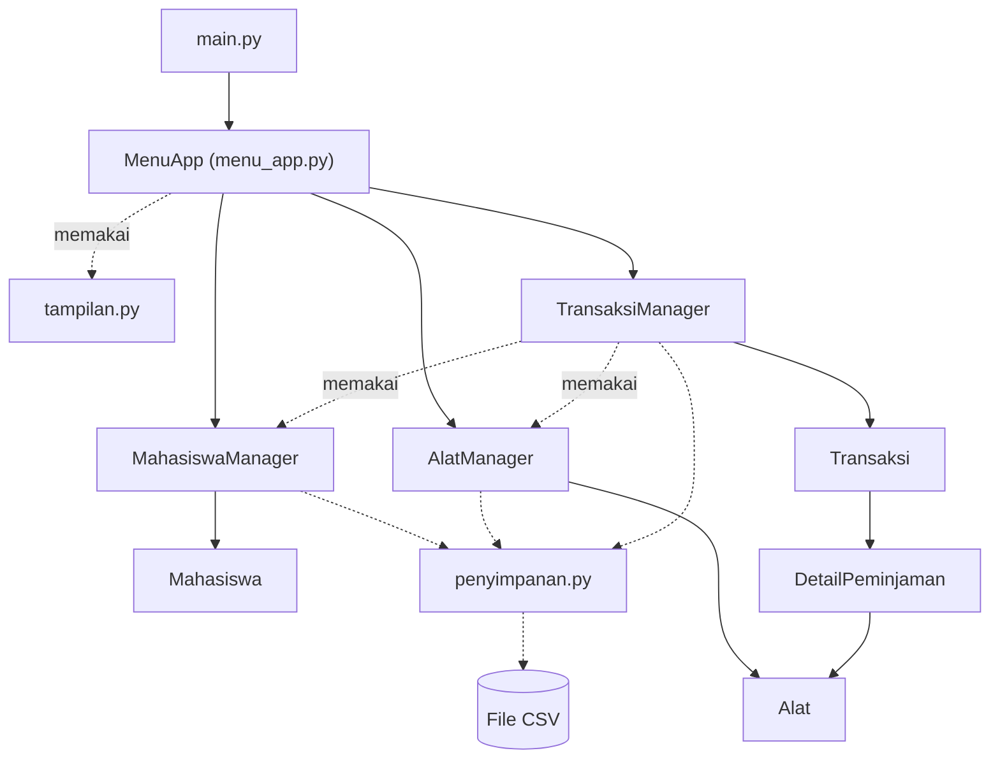

<div align="center">

# 🔬 Sistem Peminjaman Peralatan Laboratorium

**Aplikasi terminal berbasis Python OOP untuk mencatat peminjaman alat laboratorium oleh mahasiswa.**


</div>

## 📑 Daftar Isi

1. [Nama Aplikasi](#-nama-aplikasi)
2. [Anggota Kelompok](#-anggota-kelompok)
3. [Deskripsi Sistem](#-deskripsi-sistem)
4. [Struktur Program](#-struktur-program)
5. [Keandalan Data dan Algoritma](#-keandalan-data-dan-algoritma)
6. [Cara Menjalankan](#-cara-menjalankan)
7. [Pengujian](#-pengujian)
8. [Pembagian Kontribusi](#-pembagian-kontribusi)


## 📌 Nama Aplikasi

**Sistem Peminjaman Peralatan Laboratorium**

Aplikasi ini dibuat dengan Python dan dijalankan lewat terminal. Data disimpan di file **CSV** (folder `Data_Sistem/`) dan **tersimpan otomatis** setiap selesai satu aksi yang mengubah data, tanpa database.


## 👥 Anggota Kelompok

**Kelompok 3**

| No | Nama | NIM | Akun GitHub |
|:--:|------|-----|-------------|
| 1 | Farrel Muflif Muzzaki | K3525024 | [@relzajaa](https://github.com/relzajaa) |
| 2 | Gisma Dian Utami | K3525026 | [@gismadian](https://github.com/gismadian) |
| 3 | Nourin Akbar Pratama | K3525067 | [@Akbarr-11](https://github.com/Akbarr-11) |
| 4 | Azzahra Hendar Asafira | K3525081 | [@azzahrahendar](https://github.com/azzahrahendar) |


## 📝 Deskripsi Sistem

Sistem ini membantu petugas lab mencatat **siapa** meminjam **alat apa**, **kapan** harus kembali, dan **bagaimana kondisi** alat saat dikembalikan.

### ✨ Fitur

| Menu | Fitur | Keterangan |
|:--:|-------|------------|
| 1 | Kelola Data Mahasiswa | Tambah, edit, hapus, cari, dan lihat daftar mahasiswa |
| 2 | Kelola Data Alat | Tambah (bisa banyak unit sekaligus), edit, hapus, cari, lihat daftar, dan tambah kategori |
| 3 | Buat Transaksi Peminjaman | Satu transaksi boleh berisi beberapa alat, lama pinjam 1–7 hari |
| 4 | Tampilkan Transaksi | Semua transaksi beserta detailnya, ada tanda **TERLAMBAT** |
| 5 | Proses Pengembalian Alat | Alat dikembalikan satu per satu, lengkap dengan kondisi dan tanggal |
| 6 | Cari Transaksi Berdasarkan Mahasiswa | Cari memakai NIM |
| 7 | Tampilkan Alat yang Tersedia | Daftar alat dan jumlah stok |
| 8 | Tampilkan Alat yang Sedang Dipinjam | Alat yang belum kembali |
| 9 | Tampilkan Alat yang Rusak | Alat berkondisi rusak ringan atau rusak berat |
| 10 | Tampilkan Riwayat Peminjaman Mahasiswa | Transaksi yang sudah selesai, terbaru di atas |
| 11 | Keluar dari Program | Menutup aplikasi |
| 12 | Pencarian Alat | Cari berdasarkan kode, nama, atau kategori |
| 13 | Statistik Peminjaman | Alat terpopuler, mahasiswa teraktif, jumlah transaksi aktif dan selesai |
| 14 | Lihat Alat dalam Pemeliharaan | Alat rusak yang sedang menunggu perbaikan |
| 15 | Selesaikan Pemeliharaan Alat | Alat diperbaiki lalu kembali tersedia dalam kondisi baik |

### 📋 Aturan Peminjaman

1. Satu mahasiswa maksimal punya **2 transaksi aktif**.
2. Alat hanya bisa dipinjam jika statusnya **Tersedia**.
3. Satu transaksi bisa berisi **banyak alat**. Kode alat yang diketik dua kali dihitung sekali.
4. Pengembalian dicatat **per alat** (tanggal, kondisi, dan hari terlambat). Status transaksi berubah otomatis: *Dipinjam → Sebagian dikembalikan → Selesai*.
5. Alat yang kembali **Baik** langsung tersedia. Alat **rusak** masuk *Pemeliharaan* sampai diselesaikan lewat menu 15.
6. Mahasiswa atau alat yang **sudah punya riwayat transaksi tidak bisa dihapus**, supaya riwayat tetap utuh.

Siklus status sebuah alat:



### ✅ Pemeriksaan Input

- NIM dan kode alat tidak boleh sama dengan yang sudah ada. Huruf besar/kecil tidak dibedakan (`k3525024` sama dengan `K3525024`), dan spasi di pinggir atau spasi ganda dirapikan otomatis.
- No. HP hanya angka biasa (0–9), panjang 10–13 digit.
- Tanggal kembali berformat `DD-MM-YYYY`, tidak boleh sebelum tanggal pinjam, dan tidak boleh melewati hari ini.
- Jika ada kesalahan, muncul pesan `[!]` berwarna merah dan program tidak berhenti.
- Tekan **Ctrl+C** saat sedang mengisi data untuk **membatalkan aksi itu saja**. Tekan sekali lagi di menu utama untuk keluar.

### 🖥️ Tampilan Program

Ini tampilan menu utama saat program dijalankan (garis dan kotak berwarna kuning, tulisan berwarna putih):

<pre style="background:#0c0c0c; color:#ffffff; padding:12px; overflow-x:auto; line-height:1.3">
      <span style="color:#F5F543">╔══════════════════════════════════════════════════════════════════╗</span>
      <span style="color:#F5F543">║</span>          <span style="color:#F5F543"><b>♦</b></span>  <b>SISTEM PEMINJAMAN PERALATAN LABORATORIUM</b>  <span style="color:#F5F543"><b>♦</b></span>          <span style="color:#F5F543">║</span>
      <span style="color:#F5F543">╚══════════════════════════════════════════════════════════════════╝</span>

                 Hari ini: 08-11-2026   |   Transaksi aktif: 0

      <span style="color:#F5F543">┌──────────────────────────────────────────────────────────────────┐</span>
      <span style="color:#F5F543">│</span>                            <b>MENU UTAMA</b>                            <span style="color:#F5F543">│</span>
      <span style="color:#F5F543">╞══════════════════════════════════════════════════════════════════╡</span>
      <span style="color:#F5F543">│</span>  1. Kelola Data Mahasiswa                                        <span style="color:#F5F543">│</span>
      <span style="color:#F5F543">│</span>  2. Kelola Data Alat                                             <span style="color:#F5F543">│</span>
      <span style="color:#F5F543">│</span>  3. Buat Transaksi Peminjaman                                    <span style="color:#F5F543">│</span>
      <span style="color:#F5F543">│</span>  4. Tampilkan Transaksi                                          <span style="color:#F5F543">│</span>
      <span style="color:#F5F543">│</span>  5. Proses Pengembalian Alat                                     <span style="color:#F5F543">│</span>
      <span style="color:#F5F543">│</span>  6. Cari Transaksi Berdasarkan Mahasiswa                         <span style="color:#F5F543">│</span>
      <span style="color:#F5F543">│</span>  7. Tampilkan Alat yang Tersedia                                 <span style="color:#F5F543">│</span>
      <span style="color:#F5F543">│</span>  8. Tampilkan Alat yang Sedang Dipinjam                          <span style="color:#F5F543">│</span>
      <span style="color:#F5F543">│</span>  9. Tampilkan Alat yang Rusak                                    <span style="color:#F5F543">│</span>
      <span style="color:#F5F543">│</span> 10. Tampilkan Riwayat Peminjaman Mahasiswa                       <span style="color:#F5F543">│</span>
      <span style="color:#F5F543">│</span> 11. Keluar dari Program                                          <span style="color:#F5F543">│</span>
      <span style="color:#F5F543">└──────────────────────────────────────────────────────────────────┘</span>

      <span style="color:#F5F543">┌──────────────────────────────────────────────────────────────────┐</span>
      <span style="color:#F5F543">│</span>                          <b>MENU TANTANGAN</b>                          <span style="color:#F5F543">│</span>
      <span style="color:#F5F543">╞══════════════════════════════════════════════════════════════════╡</span>
      <span style="color:#F5F543">│</span> 12. Pencarian Alat                                               <span style="color:#F5F543">│</span>
      <span style="color:#F5F543">│</span> 13. Statistik Peminjaman                                         <span style="color:#F5F543">│</span>
      <span style="color:#F5F543">│</span> 14. Lihat Alat dalam Pemeliharaan                                <span style="color:#F5F543">│</span>
      <span style="color:#F5F543">│</span> 15. Selesaikan Pemeliharaan Alat                                 <span style="color:#F5F543">│</span>
      <span style="color:#F5F543">└──────────────────────────────────────────────────────────────────┘</span>
      Pilih menu (1-15): 
</pre>

Tabel menyesuaikan lebar terminal (kolom terlebar dipersempit otomatis) dan pesan yang panjang dipecah menjadi beberapa baris. Warna otomatis dimatikan jika keluaran dialihkan ke file atau jika variabel lingkungan `NO_COLOR` diisi.


## 🗂️ Struktur Program

### 📁 Susunan Folder

```text
Project2_FIX/
├── main.py                    # pintu masuk program
├── README.md
├── Data_Sistem/               # penyimpanan data (file CSV)
│   ├── mahasiswa.csv
│   ├── alat.csv
│   ├── kategori.csv
│   ├── transaksi.csv
│   └── detail.csv
├── tests/
│   └── test_sistem.py         # 40 tes otomatis
└── Sistem_Peminjaman_Lab/
    ├── __init__.py
    ├── penyimpanan.py         # fungsi baca/tulis CSV bersama (penulisan aman)
    ├── mahasiswa.py           # Mahasiswa, penyimpanan CSV, MahasiswaManager
    ├── alat.py                # Enum, Alat, penyimpanan CSV, AlatManager
    ├── transaksi.py           # Enum, Transaksi, penyimpanan CSV, TransaksiManager
    ├── menu_app.py            # menu dan alur input (UI)
    └── tampilan.py            # fungsi bantu cetak di terminal
```

### 🧱 Empat Lapisan Program



| Lapisan | Class / File | Tugas |
|---------|--------------|-------|
| **UI** | `MenuApp`, `tampilan.py` | Menampilkan menu dan tabel, membaca input, menangkap pesan error. Tidak berisi aturan data |
| **Manager** | `MahasiswaManager`, `AlatManager`, `TransaksiManager` | Menyimpan data di `dict` dan memeriksa semua aturan |
| **Penyimpanan** | `PenyimpananMahasiswa`, `PenyimpananAlat`, `PenyimpananTransaksi`, `penyimpanan.py` | Mengubah objek menjadi baris CSV dan sebaliknya; `penyimpanan.py` menulis file dengan aman |
| **Domain** | `Mahasiswa`, `Alat`, `Transaksi`, `DetailPeminjaman`, Enum | Objek data dan pilihan tetap |

### 🧩 Class dan Enum (11 class + 3 enum)

| Jenis | Nama | File | Tugas |
|-------|------|------|-------|
| Class | `MenuApp` | `menu_app.py` | Menjalankan menu 1–15 dan submenunya |
| Class | `MahasiswaManager` | `mahasiswa.py` | Mengelola data mahasiswa (kunci = NIM) |
| Class | `AlatManager` | `alat.py` | Mengelola data alat, kategori, dan pemeliharaan (kunci = kode alat) |
| Class | `TransaksiManager` | `transaksi.py` | Membuat transaksi, memproses pengembalian, riwayat, dan statistik (kunci = ID seperti `TRX001`) |
| Class | `Mahasiswa` | `mahasiswa.py` | Data mahasiswa dan daftar transaksi aktifnya |
| Class | `Alat` | `alat.py` | Data alat beserta kondisi dan statusnya |
| Class | `Transaksi` | `transaksi.py` | Satu peminjaman: tanggal, batas kembali, status, dan daftar alat |
| Class | `DetailPeminjaman` | `transaksi.py` | Catatan satu alat di dalam transaksi |
| Class | `PenyimpananMahasiswa` | `mahasiswa.py` | Baca dan tulis `mahasiswa.csv` |
| Class | `PenyimpananAlat` | `alat.py` | Baca dan tulis `alat.csv` dan `kategori.csv` |
| Class | `PenyimpananTransaksi` | `transaksi.py` | Baca dan tulis `transaksi.csv` dan `detail.csv` |
| Enum | `StatusTransaksi` | `transaksi.py` | `DIPINJAM`, `SEBAGIAN_DIKEMBALIKAN`, `SELESAI` |
| Enum | `KondisiAlat` | `alat.py` | `BAIK`, `RUSAK_RINGAN`, `RUSAK_BERAT` |
| Enum | `StatusAlat` | `alat.py` | `TERSEDIA`, `DIPINJAM`, `PEMELIHARAAN` |

Selain itu ada `Menu` (`namedtuple` di `menu_app.py`) sebagai pembungkus satu butir menu: nama, fungsi, apakah perlu jeda, dan apakah mengubah data.

### 🗃️ Struktur Data yang Dipakai

| Struktur | Dipakai untuk |
|----------|---------------|
| `dict` | Tempat menyimpan data tiap manager, daftar menu, dan indeks transaksi per mahasiswa |
| `list` | Daftar alat dalam transaksi dan hasil pencarian |
| `set` | Kategori alat dan ID transaksi aktif mahasiswa (tidak boleh ganda) |
| `tuple` | Pasangan `(nama, jumlah)` pada statistik dan `namedtuple` `Menu` |
| File `csv` | Penyimpanan data supaya tidak hilang saat program ditutup |


## 🛡️ Keandalan Data dan Algoritma

### 💾 Penyimpanan yang Aman

| Masalah yang dicegah | Cara kerjanya |
|----------------------|---------------|
| File CSV rusak setengah tertulis saat program mati atau error | Data ditulis ke file `.tmp` dulu, baru menggantikan file asli dalam satu langkah (`os.replace`). File asli tidak pernah berisi data setengah jadi |
| Data di layar berbeda dari data di file | Jika aksi gagal (error, file dikunci Excel, atau Ctrl+C), data di memori dipulihkan dari file |
| File ditulis tanpa perlu | Menu yang hanya menampilkan data tidak menulis file sama sekali. Penyimpanan hanya terjadi setelah aksi yang mengubah data |
| Nama berhuruf non-ASCII rusak di Windows | File dibaca dan ditulis dengan UTF-8; file hasil simpan dari Excel (dengan BOM) tetap terbaca |

### 🔍 Pemeriksaan Isi File CSV saat Program Dibuka

Jika file CSV diedit manual dan isinya bertentangan, program berhenti dengan pesan yang jelas dan **tidak menimpa** file tersebut. Yang diperiksa: NIM, kode alat, atau ID transaksi ganda; ID transaksi yang bentuknya salah; detail yang merujuk transaksi yang tidak ada; dan satu alat yang tercatat dipinjam di dua transaksi aktif sekaligus. Status **Dipinjam** pada `alat.csv` tidak dipercaya begitu saja, melainkan dihitung ulang dari `detail.csv`, sehingga alat tidak bisa "tersangkut" berstatus dipinjam tanpa transaksi.

### ⚙️ Pilihan Algoritma

| Proses | Cara | Kompleksitas |
|--------|------|:------------:|
| Cari mahasiswa / alat berdasarkan NIM / kode | `dict` dengan NIM / kode sebagai kunci | O(1) |
| Cari transaksi milik satu mahasiswa | Indeks `dict` `{nim: [transaksi]}`, tidak menelusuri semua transaksi | O(jumlah transaksi mahasiswa itu) |
| Buang kode alat ganda dalam satu transaksi | `dict.fromkeys` (menjaga urutan) | O(k) |
| Tambah banyak unit alat | Semua unit diperiksa dulu, baru disimpan: kalau satu bermasalah, tidak ada yang masuk | O(n + jumlah unit) |
| Peringkat statistik | Diurutkan menurut jumlah, lalu abjad, sehingga hasil selalu sama untuk data yang sama | O(m log m) |
| Lebar kolom tabel | Kolom terlebar dipersempit satu per satu sampai muat di layar | O(kolom x kelebihan) |

Status `statusAktif` pada mahasiswa dihitung dari daftar transaksi aktifnya (`@property`), bukan disimpan terpisah, jadi tidak mungkin tidak sinkron.


## 🚀 Cara Menjalankan

### 🔧 Yang Dibutuhkan

- **Python 3.8 atau lebih baru** (sudah diuji di Python 3.12)
- Terminal yang bisa menampilkan warna dan karakter Unicode (Windows Terminal, PowerShell, macOS Terminal, atau terminal Linux)
- Tidak perlu `pip install` apa pun
- Atau buka `main.py` di editor (misalnya VS Code), lalu klik tombol play di pojok kanan atas untuk Run

### ▶️ Langkah-langkah

```bash
# 1. Masuk ke folder proyek
cd Project2_FIX

# 2. Jalankan program
python main.py          # Windows
python3 main.py         # macOS / Linux
```

### 💡 Contoh Alur Pemakaian

File CSV awal hanya berisi judul kolom, jadi **isi data dulu**:

1. **Menu 1** → tambah mahasiswa (NIM, nama, No. HP).
2. **Menu 2** → tambah alat. Contoh: kode `MKS`, jumlah `3` → otomatis jadi `MKS-01`, `MKS-02`, `MKS-03`.
3. **Menu 3** → buat peminjaman (NIM, kode alat dipisah koma, lama pinjam).
4. **Menu 5** → kembalikan alat (pilih transaksi, kode alat, kondisi, tanggal).
5. **Menu 14 dan 15** → lihat dan selesaikan pemeliharaan jika ada alat yang dikembalikan dalam keadaan rusak.
6. **Menu 4, 10, 13** → lihat transaksi, riwayat, dan statistik.

> 💾 Data tersimpan otomatis ke folder `Data_Sistem/`, jadi tetap ada saat program dibuka lagi.
>
> ⚠️ Jangan membuka file CSV di Excel saat program berjalan. Jika penyimpanan gagal, program menampilkan pesan, membatalkan perubahan itu, dan tetap berjalan; tutup Excel lalu ulangi aksinya.


## 🧪 Pengujian

Ada **40 tes otomatis** di `tests/test_sistem.py` yang memeriksa aturan tiap manager, simpan dan muat ulang data, file CSV yang rusak, tampilan tabel, dan alur menu dari awal sampai akhir (input pengguna disimulasikan). Tes memakai folder sementara, jadi isi `Data_Sistem/` tidak tersentuh.

```bash
# dari folder Project2_FIX
python -m unittest -v          # Windows
python3 -m unittest -v         # macOS / Linux
```

Hasil yang diharapkan: `Ran 40 tests ... OK`. Jalankan ulang setiap kali ada anggota yang mengubah kodenya.


## 🤝 Pembagian Kontribusi

| Anggota | File yang Dikerjakan | Isi Tugas |
|---------|----------------------|-----------|
| **Farrel Muflif Muzzaki** | `mahasiswa.py`, `menu_app.py`, `main.py` | `Mahasiswa`, `PenyimpananMahasiswa`, `MahasiswaManager` dan aturan data mahasiswa; menu utama dan submenu, alur input pengguna, menu tantangan; pintu masuk program |
| **Gisma Dian Utami** | `alat.py`, `README.md` | Enum `KondisiAlat` dan `StatusAlat`, `Alat`, `PenyimpananAlat`, `AlatManager` (kategori, pencarian, pemeliharaan); README bagian nama aplikasi, deskripsi sistem, fitur, dan aturan |
| **Azzahra Hendar Asafira** | `transaksi.py`, `penyimpanan.py`, `tests/test_sistem.py` | Enum `StatusTransaksi`, `Transaksi`, `DetailPeminjaman`, `PenyimpananTransaksi`, `TransaksiManager` (aturan peminjaman, pengembalian, riwayat, statistik); fungsi penyimpanan CSV yang aman; pengujian otomatis |
| **Nourin Akbar Pratama** | `tampilan.py`, `README.md` | Tampilan terminal (warna, kotak, tabel, pesan); README bagian struktur program, keandalan data, cara menjalankan, dan pengujian |

<div align="center">

**Created by Kelompok 3**

</div>